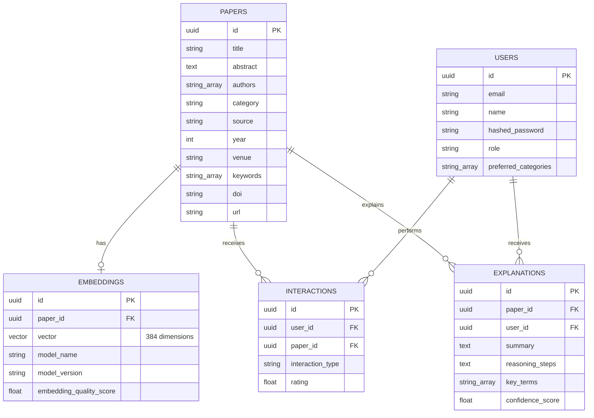

# Research Recommendation System — Codebase Overview & Guide

## 1. Introduction

The **Research Paper Recommendation System** is an end-to-end, full-stack application built to deliver intelligent, semantic-driven literature recommendations for **Software Engineering (SE)** researchers, paired with an Explainable AI (XAI) engine that articulates *why* papers were selected.

This document provides a comprehensive code walkthrough of the entire repository, detailing its modular layout, execution flows, data models, and component responsibilities.

---

## 2. Monorepo Structure

The repository is structured as a monorepo partitioned into application runtimes, shared domain packages, infrastructure scripts, and evaluation suites:

```
RESEARCH RECOMMENDATION SYSTEM - FYP/
├── apps/
│   ├── api/                      # FastAPI Python Backend
│   └── web/                      # Next.js 15 TypeScript Frontend
├── packages/
│   ├── data_ingestion/           # Academic API harvesters & text processors
│   ├── nlp/                      # Embedding encoders, SE query expanders & baselines
│   └── shared/                   # Domain constants, types, and metrics
├── infrastructure/
│   └── database/                 # Alembic migrations and database seeding scripts
├── experiments/                  # Evaluation notebooks, benchmarking scripts, datasets
├── scripts/                      # Evaluation execution scripts (coherence, ranking quality)
└── docs/                         # Project technical documentation
```

---

## 3. Backend Architecture (`apps/api`)

The backend is built with **FastAPI** running on Python 3.11+ with an asynchronous runtime (`asyncio`, `uvicorn`). It employs an **N-Tier Layered Architecture** with strict boundaries between presentation, service orchestration, and data access.

### 3.1 Application Entrypoint & Lifecycle
- **`src/main.py`**:
  - Initializes the `FastAPI` application instance, metadata, and CORS middleware.
  - Implements the `@asynccontextmanager` **`lifespan`** hook:
    - **Pre-warming**: Instantiates [`EmbeddingService`](file:///c:/Users/HP/OneDrive/Desktop/CODING FILES/2026/RESEARCH RECOMMENDATION SYSTEM - FYP/apps/api/src/services/embedding_service.py) and runs a dummy encoding pass on startup to eliminate cold-start latency for the first user query.
    - **Baseline Warmup**: Instantiates [`BaselineService`](file:///c:/Users/HP/OneDrive/Desktop/CODING FILES/2026/RESEARCH RECOMMENDATION SYSTEM - FYP/apps/api/src/services/baseline_service.py) to fit the TF-IDF vectorizer over the corpus asynchronously.
- **`src/config.py`**:
  - Centralized type-safe settings loaded from `.env` via `pydantic-settings`.
  - Defines database pools, JWT secrets, embedding model identifiers (`all-MiniLM-L6-v2`), cache TTLs, and LLM provider credentials.
- **`src/dependencies.py`**:
  - Injects per-request async database sessions (`get_db`) with automatic commit/rollback.
  - Injects authenticated user contexts (`get_current_user`) validated through OAuth2 bearer JWT tokens.

---

### 3.2 Presentation Layer (`src/routers/`)
The router layer maps HTTP endpoints, deserializes incoming payloads via Pydantic schemas, and hands off business logic execution to services:

| Router | File | Key Endpoints | Purpose |
| :--- | :--- | :--- | :--- |
| **Recommendations** | `recommendations.py` | `POST /api/v1/recommendations`<br/>`GET /api/v1/recommendations/similar/{id}` | Core entrypoint for semantic recommendations (by text query or source paper ID) with optional XAI explanations. |
| **Search** | `search.py` | `POST /api/v1/search`<br/>`POST /api/v1/search/semantic`<br/>`POST /api/v1/search/keyword`<br/>`POST /api/v1/search/compare` | Multi-mode search supporting dense vector semantic search, TF-IDF keyword search, and side-by-side comparison. |
| **Papers** | `papers.py` | `GET /api/v1/papers`<br/>`GET /api/v1/papers/{id}`<br/>`POST /api/v1/papers/{id}/save`<br/>`GET /api/v1/papers/saved` | Paper catalogue listing, pagination, metadata inspection, and user library/bookmarking actions. |
| **Auth** | `auth.py` | `POST /api/v1/auth/register`<br/>`POST /api/v1/auth/login`<br/>`POST /api/v1/auth/google/login`<br/>`GET /api/v1/auth/me` | User registration, password hashing (bcrypt), JWT issuance, and Google OAuth2 credential verification. |
| **Health** | `health.py` | `GET /api/v1/health` | Service health status, database ping, and system diagnostic metadata. |

---

### 3.3 Business Logic & Service Layer (`src/services/`)
Services contain the core algorithms, orchestration, caching, and concurrency logic:

1. **`RecommendationService`**:
   - Manages text-to-paper and paper-to-paper recommendation pipelines.
   - Enforces a minimum cosine similarity threshold (`min_recommendation_similarity = 0.5`) and caps results at `default_top_k = 100` papers.
   - Implements **thread-safe in-memory result caching** (`OrderedDict` with monotonic TTL and LRU eviction).
   - Coordinates parallel explanation generation via `asyncio.gather()`.

2. **`ExplanationService` & `LangChainExplainer`**:
   - Generates transparent, human-readable explanations using a single merged prompt per recommendation that extracts both structured reasoning steps and a concise summary in one LLM call.
   - Leverages LangChain across multiple LLM providers: **Groq** (Llama-3/Mixtral), **OpenAI**, **Anthropic**, or **Ollama**.
   - Implements **concurrency throttling** using `asyncio.Semaphore(max_concurrent=5)` to parallelize LLM generation without triggering rate limits.
   - Features a **circuit breaker & fallback mechanism**: If an LLM call fails or times out, the service automatically produces deterministic heuristic explanations based on domain keyword overlap and feature importance.

3. **`EmbeddingService`**:
   - Wraps local SentenceTransformers (`sentence-transformers/all-MiniLM-L6-v2`) generating 384-dimensional dense vectors.
   - Implements multi-level caching (a singleton `_model_cache` and an LRU `_embedding_cache` with a 1-hour TTL and 5,000-item capacity).

4. **`SearchService` & `BaselineService`**:
   - `SearchService` routes search requests based on method (`semantic`, `keyword`, `hybrid`).
   - `BaselineService` builds a sparse TF-IDF index across title, abstract, and keywords, calculating cosine similarity for comparative evaluation.

5. **`UserService` & `SavedPaperService`**:
   - Manages user profiles, research preferences, and personal bookmark collections.

---

### 3.4 Data Access Layer (`src/repositories/`)
Repositories encapsulate database queries using asynchronous SQLAlchemy 2.0:

- **`BaseRepository[T]`**: Generic CRUD repository providing `get_by_id`, `create`, `update`, and `delete`.
- **`PaperRepository`**:
  - Handles paper filtering by publication year, venue, category, and keywords.
  - Implements vector similarity queries using `pgvector`:
    ```python
    distance = Embedding.vector.cosine_distance(embedding)
    similarity = (1 - distance).label("similarity")
    query = (
        select(Paper, similarity)
        .join(Embedding, Embedding.paper_id == Paper.id)
        .where(similarity >= min_similarity)
        .order_by(distance)
        .limit(top_k)
    )
    ```
- **`UserRepository`**: User lookup by email/ID, password validation, and profile modification.
- **`InteractionRepository`**: Persists interaction events (clicks, bookmarks, searches) for analytics.

---

### 3.5 Database Models (`src/models/`)



---

## 4. NLP & Machine Learning Packages (`packages/nlp`)

The `packages/nlp` directory is a standalone Python package containing NLP components:

- **`embeddings/`**:
  - `base.py`: Abstract base class `BaseEmbeddingModel`.
  - `sentence_transformer.py`: Concrete implementation wrapping HuggingFace's `SentenceTransformer` with batch encoding and normalization.
- **`query_processor.py`**:
  - `SEDomainExpander`: Domain-specific dictionary expanding Software Engineering queries with synonyms (e.g., *"bug prediction"* → *"defect forecasting machine learning empirical study"*).
- **`explainability/`**:
  - `feature_importance.py`: Computes individual query term contribution scores by projecting term vectors against the document embedding.
  - `attention_weights.py`: Heuristics for attention analysis across text spans.
  - `explanation_generator.py`: Template-based fallback generator producing human-readable explanations when LLMs are offline.
- **`baselines/`**:
  - `tfidf.py`: Scikit-learn TF-IDF vectorizer + cosine similarity.
  - `bm25.py`: Best Matching 25 (BM25) ranking baseline.
  - `keyword.py`: Exact and fuzzy keyword matching.
- **`similarity/`**:
  - `cosine.py`: Vector cosine similarity utilities with NumPy.

---

## 5. Data Ingestion Pipeline (`packages/data_ingestion`)

Handles academic repository scraping, text normalization, and database population:

- **API Clients (`ingestion/clients/`)**:
  - `arxiv_client.py`: Harvests preprints from arXiv API.
  - `dblp_client.py`: Queries computer science bibliography.
  - `semantic_scholar_client.py`: Retrieves papers and citation graphs.
  - `doaj_client.py`: Queries Directory of Open Access Journals.
  - `zenodo_client.py`: Queries open research data and publications.
- **Processors (`ingestion/processors/`)**:
  - `paper_processor.py`: Cleans raw text, handles author formatting, extracts keywords.
  - `categorizer.py`: Rules-based classifier tagging papers under predefined Software Engineering categories (e.g., *Software Testing*, *DevOps & CI/CD*, *Machine Learning for SE*).

---

## 6. Frontend Architecture (`apps/web`)

Built with **Next.js 15 (App Router)**, **React 19**, and **Tailwind CSS v4**:

### 6.1 Application Routes (`app/`)
- **`app/page.tsx`**: Landing page presenting hero banner, search bar, and featured research categories.
- **`app/explore/page.tsx`**: Interactive paper exploration with category filters, year range sliders, and pagination.
- **`app/recommendation/page.tsx`**: The primary recommendation dashboard: accepts free-text research queries or abstract snippets, requests semantic recommendations, and displays confidence scores alongside XAI explanations.
- **`app/paper/[id]/page.tsx`**: Detailed view of a single paper with abstract, metadata, citation details, similar paper suggestions, and bookmarking toggle.
- **`app/dashboard/page.tsx`**: User dashboard displaying bookmarked/saved papers, recent activity, and customized recommendations.
- **`app/profile/page.tsx`**: User profile management and research interest preferences.
- **`app/login/` & `app/signup/`**: Authentication pages supporting traditional credential login and Google OAuth2.

### 6.2 Key Components (`components/`)
- **`SearchBar.tsx`**: Search input supporting instant semantic submission, filter toggles, and mode switching.
- **`PaperCard.tsx`**: Renders paper card with title, author badges, publication year, venue, category pill, similarity score indicator, and expandable XAI explanation accordions.
- **`PaperGrid.tsx`**: Responsive grid container displaying lists of `PaperCard` components with loading skeletons and empty states.
- **`Header.tsx` & `Footer.tsx`**: Navigation bar with user session management, theme toggle, and responsive mobile menu.

### 6.3 Client Services (`lib/`)
- **`lib/api.ts`**: Centralized HTTP client communicating with the FastAPI backend (`/api/v1/`). Handles bearer token injection and response typing.
- **`lib/auth.ts`**: Client-side session management, JWT token persistence in `localStorage`, and role-based access.
- **`lib/google-auth.ts`**: Google Sign-In SDK initialization and credential transmission.

---

## 7. Scripts & Evaluation (`experiments/` & `scripts/`)

Empirical testing tools used for validating recommendation accuracy and latency:

- **`experiments/evaluation/metrics.py`**:
  - Implements standard Information Retrieval (IR) evaluation metrics:
    - Precision@K ($P@K$)
    - Recall@K ($R@K$)
    - F1@K ($F_1@K$)
    - Mean Average Precision (MAP)
    - Mean Reciprocal Rank (MRR)
    - Normalized Discounted Cumulative Gain (NDCG@K)
- **`experiments/evaluation/benchmark.py`**:
  - Executes batch comparative benchmarks across `semantic`, `tfidf`, `bm25`, and `keyword` search methods.
- **`scripts/evaluate_semantic_vs_tfidf.py`**:
  - Compares semantic vector search against TF-IDF on 20 standard SE queries, demonstrating that semantic search achieves superior semantic coherence (+10.1% mean coherence, winning 80% of test queries).

---

## 8. Summary of Execution Flow

```
1. Researcher submits query: "detecting vulnerabilities in smart contracts"
                      │
                      â–¼
2. Frontend (Next.js): POST /api/v1/recommendations {query_text, include_explanation: true}
                      │
                      â–¼
3. RecommendationService:
   a. Check in-memory result cache -> Miss
   b. EmbeddingService.encode_text() -> 384-d vector (cached in LRU)
   c. PaperRepository.search_by_embedding() -> pgvector executes <=> distance join
   d. Returns up to top_k=100 matching papers with similarity >= 0.5
   e. Parallel Explanation Generation (asyncio.gather bounded by Semaphore):
      - Extracts key terms: ["vulnerabilities", "smart contracts", "security", "audit"]
      - LangChainExplainer sends 1 merged prompt to Groq (Llama-3): generates reasoning & summary together
      - (Fallback triggers automatically if rate limit or timeout occurs)
   f. Result cached in-memory with TTL
                      │
                      â–¼
4. Next.js UI receives JSON -> Renders PaperCards with similarity %, tags, and AI explanation
```

