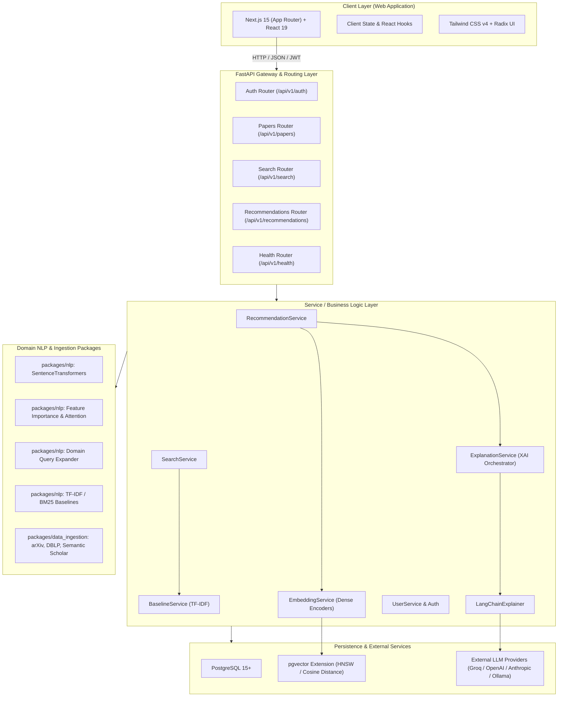
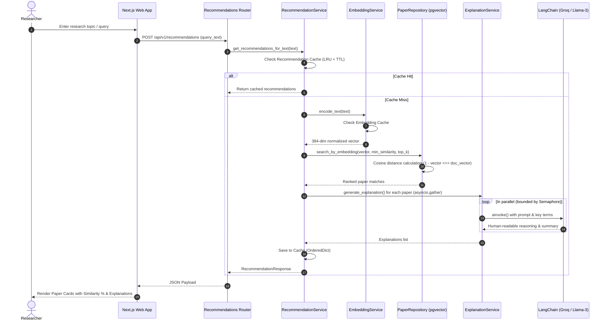

# Research Recommendation System — System Architecture, Design Patterns & Frameworks

## 1. Executive Summary & System Overview

The **Intelligent and Explainable Semantic Research Paper Recommendation System** is an academic research platform tailored specifically for the **Software Engineering (SE)** domain. It tackles two prominent challenges in academic discovery:
1. **The Lexical Search Bottleneck**: Traditional keyword-based search (TF-IDF, BM25) fails when researchers use terminology divergent from published papers (e.g., searching for *"bug prediction"* vs. papers titled *"defect forecasting with machine learning"*).
2. **The "Black-Box" Recommendation Problem**: State-of-the-art neural recommenders output relevance scores without human-understandable justifications, leaving researchers uncertain about *why* a particular paper was suggested.

### Core Capabilities
- **Semantic Vector Search**: Deep conceptual understanding of paper abstracts and research queries using dense SentenceTransformers embeddings (`all-MiniLM-L6-v2` / SPECTER) paired with PostgreSQL's `pgvector` extension for high-performance cosine similarity queries.
- **Explainable AI (XAI) Engine**: Multi-step reasoning pipeline combining LLM orchestration (LangChain + Groq / OpenAI / Anthropic / Ollama) with algorithmic feature-importance analysis to deliver transparent, natural-language justifications for recommendations.
- **Fault-Tolerant Hybrid Architecture**: Dual-engine search providing both neural semantic search and a TF-IDF baseline, coupled with heuristic fallbacks if LLM inference is rate-limited or offline.
- **Concurrent Async Performance**: High-throughput non-blocking request pipelines using `asyncio.gather` bounded by `asyncio.Semaphore` to generate multi-paper explanations in parallel (5–10x latency reduction).
- **Modern Responsive Frontend**: Full-stack web application built on Next.js 15 (App Router), React 19, and Tailwind CSS.

---

## 2. System Architecture

The system is architected as a **modular monorepo** with strict layer separation, clean domain boundaries, and asynchronous data flows.

### 2.1 High-Level Architecture



### 2.2 Clean Layered Backend Architecture

The backend (`apps/api`) implements a strict **Layered (N-Tier) Architecture**:

```
HTTP Request
     │
     â–¼
[Routers Layer] (apps/api/src/routers/)
  • Validates incoming requests using Pydantic schemas.
  • Enforces authentication via OAuth2/JWT dependencies.
  • Maps HTTP methods and routes to Service calls.
     │
     â–¼
[Services Layer] (apps/api/src/services/)
  • Encapsulates business logic, recommendation flows, and XAI orchestration.
  • Coordinates embedding generation, vector querying, and LLM reasoning.
  • Manages in-memory LRU caching and concurrency limits.
     │
     â–¼
[Repositories Layer] (apps/api/src/repositories/)
  • Abstracts database queries through async SQLAlchemy 2.0 sessions.
  • Executes pgvector `<=>` cosine distance operations.
  • Contains entity-specific CRUD logic.
     │
     â–¼
[Data Layer / Database]
  • PostgreSQL 15+ tables: `papers`, `embeddings`, `users`, `interactions`, `explanations`.
```

---

## 3. Core Functional Workflows

### 3.1 Data Ingestion & Preprocessing Pipeline
1. **Multi-Source Harvester**: Connectors in `packages/data_ingestion/ingestion/clients/` fetch papers from arXiv, DBLP, Semantic Scholar, DOAJ, and Zenodo.
2. **Text Normalization & Deduplication**: Cleans LaTeX markup, extracts metadata (title, abstract, authors, year, venue, DOI), and enforces deduplication via a unique composite index `(title, authors)`.
3. **Domain Categorization**: The `PaperCategorizer` tags papers against Software Engineering taxonomies (e.g., Software Testing, CI/CD & DevOps, Code Review, Program Analysis, Software Security).
4. **Vector Embedding**: Abstracts and titles are encoded into 384-dimensional dense vectors using `sentence-transformers/all-MiniLM-L6-v2` and inserted into PostgreSQL using pgvector's `Vector(384)`.

### 3.2 Semantic Recommendation Workflow


### 3.3 Explainable AI (XAI) Multi-Tier Reasoning
The system implements a resilient, multi-tiered explainability pipeline:
1. **Salient Term Extraction**: Evaluates overlapping domain vocabulary between query and paper using domain-specific SE lexicons (`packages/nlp/src/query_processor.py`) and term contribution analysis (`packages/nlp/src/explainability/feature_importance.py`).
2. **Generative LLM Reasoning**: Utilizes `LangChainExplainer` via non-blocking `ainvoke()` to articulate why the paper aligns with the researcher's query, highlighting key methodological contributions.
3. **Concurrency Control**: A semaphore (`asyncio.Semaphore(max_concurrent=5)`) prevents burst rate-limiting against external LLM providers (e.g., Groq API tier limits).
4. **Deterministic Heuristic Circuit Breaker**: If an LLM call fails, times out, or exhausts API credits, the system toggles `_llm_failed = True` and gracefully falls back to rule-based templated explanations without interrupting the user's experience.

---

## 4. Software Design Patterns

The codebase adheres strictly to proven software engineering design patterns:

### 4.1 Repository Pattern
- **Files**: `apps/api/src/repositories/base.py`, `paper_repository.py`, `user_repository.py`.
- **Purpose**: Decouples business logic from SQLAlchemy ORM queries and PostgreSQL vector operations. All complex pgvector operators (`<=>`, `.cosine_distance()`) are cleanly isolated within the repository layer.
- **Implementation**:
  ```python
  class BaseRepository(Generic[ModelType]):
      def __init__(self, db: AsyncSession, model: type[ModelType]):
          self.db = db
          self.model = model
  ```

### 4.2 Service Layer Pattern
- **Files**: `apps/api/src/services/` (`recommendation_service.py`, `search_service.py`, `explanation_service.py`, `embedding_service.py`, `baseline_service.py`).
- **Purpose**: Consolidates business workflows and cross-cutting concerns (e.g., caching, orchestration, concurrency control) into reusable, single-responsibility services rather than scattering them across router handlers.

### 4.3 Dependency Injection (DI) Pattern
- **Files**: `apps/api/src/dependencies.py`, `apps/api/src/routers/`.
- **Purpose**: Leverages FastAPI's `Depends` system for runtime resolution of async database sessions (`get_db`) and JWT-authenticated user entities (`get_current_user`), promoting testability and loose coupling.

### 4.4 Strategy Pattern
- **Search Strategy**: `SearchService` dynamically selects between `SearchMethod.SEMANTIC` (dense vector embeddings), `SearchMethod.KEYWORD` (sparse TF-IDF vectorizer), and `SearchMethod.HYBRID` (fused ranking).
- **LLM Provider Strategy**: `LangChainExplainer` wraps multiple LLM backends (Groq, OpenAI, Anthropic, Ollama) behind a single `generate_explanation()` interface, configured via environment variables.

### 4.5 Fallback & Circuit Breaker Pattern
- **Files**: `apps/api/src/services/explanation_service.py`.
- **Purpose**: Guarantees zero downtime in the face of third-party LLM rate limits or outages. The service catches exceptions from `ainvoke()`, activates `_llm_failed`, and shifts to `_generate_heuristic_explanation()`.

### 4.6 Multi-Tier Singleton & In-Memory LRU Cache Pattern
- **Files**: `apps/api/src/services/embedding_service.py`, `recommendation_service.py`, `apps/api/src/config.py`.
- **Purpose**:
  - `get_settings()` uses `@lru_cache()` as a configuration singleton.
  - `EmbeddingService` maintains a thread-safe `_model_cache` to ensure the neural model is loaded into memory only once during application startup.
  - `_embedding_cache` and `_result_cache` use thread-safe `OrderedDict` structures with monotonic TTL eviction, eliminating redundant vector encodings and database lookups.

### 4.7 Leaky Bucket / Semaphore Concurrency Pattern
- **Files**: `apps/api/src/services/explanation_service.py`.
- **Purpose**: Employs `asyncio.Semaphore(max_concurrent=5)` to throttle simultaneous calls to external LLM endpoints, maximizing throughput while remaining strictly within API quota limits.

---

## 5. Technology Stack & Frameworks

### 5.1 Backend & Machine Learning
| Layer / Tool | Technology | Version | Purpose |
| :--- | :--- | :--- | :--- |
| **API Framework** | FastAPI | `0.128.0` | High-performance asynchronous REST API framework |
| **ASGI Server** | Uvicorn | `0.27.0` | Lightning-fast ASGI web server implementation |
| **Schema Validation** | Pydantic / Pydantic Settings | `^2.7.0` | Strict data validation, DTO serialization, and environment configuration |
| **ORM & Database Client** | SQLAlchemy (asyncio) / psycopg3 | `2.0.25` / `3.2.3` | Async PostgreSQL object-relational mapping |
| **Database Migrations** | Alembic | `1.13.1` | Schema version control and migration tracking |
| **Vector Search Engine** | pgvector | `0.2.4` | In-database cosine vector indexing and `<=>` nearest-neighbor search |
| **Embedding Model** | `sentence-transformers` | `5.2.2` | Dense sentence embedding generation (`all-MiniLM-L6-v2`, 384 dims) |
| **Deep Learning Engine** | PyTorch / HuggingFace Transformers | `2.10.0` / `5.0.0` | Underlying tensor execution for embedding models |
| **Traditional IR Baseline** | scikit-learn / NLTK | `1.8.0` / `3.9.3` | TF-IDF Vectorizer and text tokenization for baseline benchmarking |
| **LLM Orchestration (XAI)** | LangChain / LangGraph | `^0.1.0` / `1.1.6` | Prompt management and provider abstraction for explanations |
| **LLM Inference Provider** | Groq / OpenAI / Anthropic / Ollama | `groq==0.37.1` | Ultra-fast inference with Llama-3 / Mixtral for reasoning generation |
| **Authentication** | `python-jose` / `passlib` / `google-auth` | `3.3.0` / `1.7.4` | JWT bearer token issuing, bcrypt password hashing, and Google OAuth2 |

### 5.2 Frontend & UI
| Layer / Tool | Technology | Version | Purpose |
| :--- | :--- | :--- | :--- |
| **Framework** | Next.js (App Router) | `15.2.6` | Server-Side Rendering (SSR), Client components, and API routing |
| **Library** | React | `19.0.0` | Reactive component tree and UI rendering |
| **Language** | TypeScript | `^5.0.0` | Static typing and compile-time contract enforcement |
| **Styling** | Tailwind CSS / PostCSS | `^4.1.9` | Utility-first responsive CSS styling |
| **UI Component Primitives** | Radix UI (`@radix-ui/*`) | `1.x` | Accessible, unstyled UI components (Dialog, Dropdown, Tabs, Tooltip) |
| **Icons & Visuals** | Lucide React | `^0.454.0` | Clean, modern iconography |
| **Charts & Metrics** | Recharts | `2.15.4` | Evaluation results and similarity score visualizations |
| **Forms & Validation** | React Hook Form + Zod | `^7.60.0` / `3.25.76` | Type-safe form validation and state management |
| **Notifications** | Sonner | `^1.7.4` | Toast alerts for bookmarking, auth, and search feedback |

---

## 6. Directory Structure Overview

```
├── apps/
│   ├── api/                      # FastAPI Backend Application
│   │   ├── src/
│   │   │   ├── core/             # Enums, custom exceptions, security, logging
│   │   │   ├── middleware/       # Rate limiting & request context middleware
│   │   │   ├── models/           # SQLAlchemy ORM models (Paper, Embedding, User, Interaction, Explanation)
│   │   │   ├── repositories/     # Data Access Layer (BaseRepository, PaperRepository, UserRepository)
│   │   │   ├── routers/          # FastAPI Route handlers (auth, papers, search, recommendations, health)
│   │   │   ├── schemas/          # Pydantic Request/Response DTO models
│   │   │   └── services/         # Business logic & XAI orchestration
│   │   └── tests/                # Backend unit and integration test suite
│   └── web/                      # Next.js 15 App Router Frontend
│       ├── app/                  # App routes: /explore, /dashboard, /paper/[id], /recommendation, /profile
│       ├── components/           # Reusable UI components (PaperCard, SearchBar, Header, Footer)
│       └── lib/                  # Frontend API client, auth helpers, Google auth handler
├── packages/
│   ├── data_ingestion/           # Harvester pipeline (arXiv, DBLP, Semantic Scholar, DOAJ, Zenodo)
│   ├── nlp/                      # NLP core (SentenceTransformers, query expansions, XAI feature importance)
│   └── shared/                   # Shared taxonomy constants, common types, metric definitions
├── infrastructure/
│   └── database/                 # Alembic migrations, database setup, and seed scripts
├── experiments/                  # Evaluation notebooks, ablation benchmarks, and ranking quality tests
└── docs/                         # Technical documentation & deployment guides
```

---

## 7. Performance & Evaluation Summary

The system includes empirical benchmarking scripts in `scripts/` and `experiments/` evaluating recommendation effectiveness:
- **Semantic Coherence**: Semantic vector search outperforms keyword baselines by capturing synonymy across diverse SE subfields (e.g., automated refactoring, mutation testing, technical debt).
- **Ranking Quality**: Evaluated using Mean Reciprocal Rank (MRR) and Normalized Discounted Cumulative Gain (NDCG@K).
- **Latency Optimization**: Pre-warming the SentenceTransformer model on FastAPI startup (`lifespan`) and executing LLM explanations concurrently reduces end-to-end recommendation response time from **~25s down to 2–4s**.

